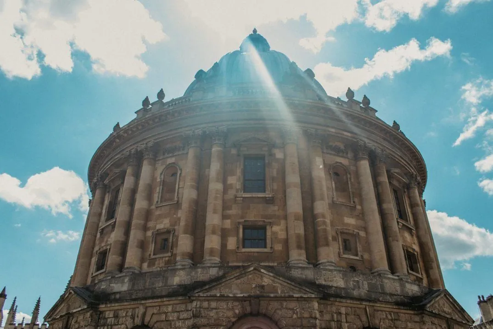
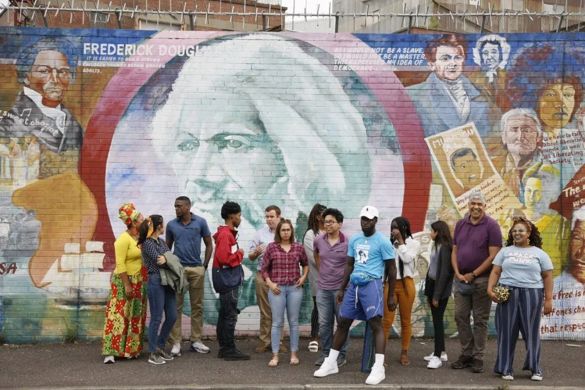
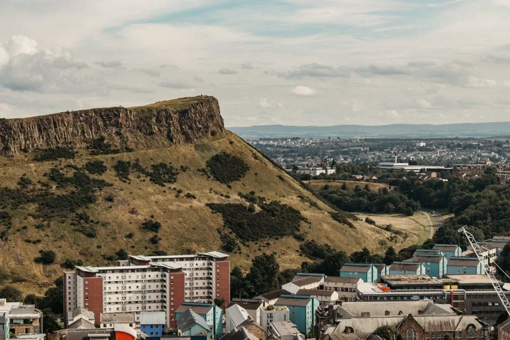
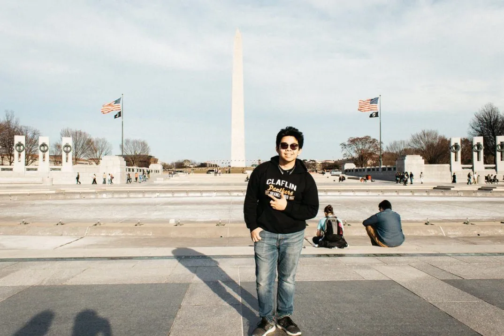
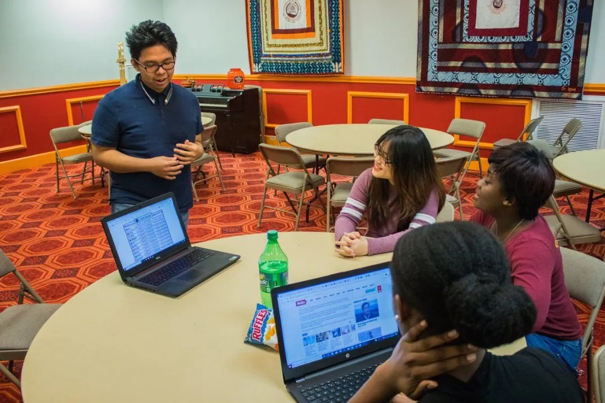
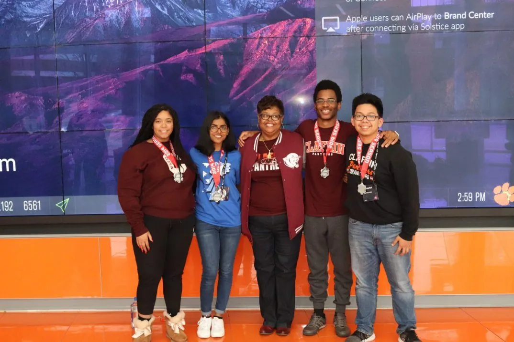
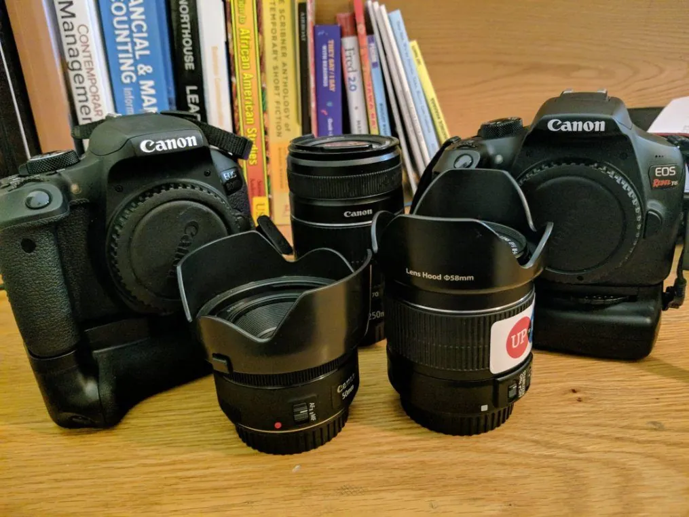

2019 has been an incredible year full of stepping out of my comfort zone, meeting new friends, and having more experiences! In fact, I can still vividly remember when I studied abroad in United Kingdom last summer, not knowing what lies ahead of me. 2019 has also been a year full of cultivating self-realization, self-discovery, and self-awareness. This is my first time writing an end of year review as well! Let’s jump to the highlights!

## Highlights
- Studied abroad in London, England with a full scholarship as a Frederick Douglass Global Fellow!
- Established my own photography business (FMU Photography).
- Won a Hackathon and a Business Plan Competition.
- Attended 12 different conferences representing Claflin University.
- Attended the National Fiscal Summit at Washington DC and met policymakers along with Nancy Pelosi and other congressional leaders.
- Visited 18 states in the United States all paid by different companies.
- Served as a Luard Morse Ambassador promoting the importance of Historically Black Universities in the community and the United Methodist Church.
- Finished 2 different research proposals and presented it in various research symposiums.
- Did I mention that I also got a brand new guitar and an electric guitar? :P

## Studying Abroad in London, England
Last March, I can still remember when I got a call from the Center of International Education Exchange saying that I got accepted as a Frederick Douglass Global Fellow. It has been the most amazing experience that I had in the whole year, in fact, maybe my whole life! I got to travel in London, England with a full scholarship where I met ten other fellows and we literally stayed together the whole time and formed memories that will last us for a lifetime.

My most memorable memory happened around 2 am. As a photographer, I love taking pictures at night. I was busy admiring the dazzling scenery full of lit buildings, when all of a sudden, my phone began to ring and I saw that my phone is around 6%. Not knowing what to do, I texted my cohort my location and asking them to pick me up, although really, it was a joke. I know that there is no way they are still awake, let alone leave their comfy beds in the middle of the morning just to get this guy who they barely knew for a month.

But, all of a sudden, the next thing I know, I can hear their voices. Their loud shouts filling the empty streets of Westminster.

## Travelling to Belfast, Ireland and Edinburgh, Scotland
During my time at United Kingdom, my cohort was also granted the opportunity to visit Belfast, Ireland where we learned about the role that Northern Ireland have in the potential event that has been going on for so long. You guessed it… Brexit.

Belfast is a really great place that is full of heartwarming stories and streets that speaks memories to you as you walk by, looking at the portraying images on the walls. Oh yeah, we visited the congressional building, Titanic museum, and the freedom wall! But, most of all, we went hiking! Wew! Another step outside of my own comfort zone!!

On the last week of July, my friends and I were planning of going to Paris, because duhh, we were already in United Kingdom and like the plane ticket is only around $150.00. Unfortunately, since I was still a green card holder, and I didn’t have the right visa to enter Europe, I was not able to go with them. It was a very sad moment, but Daniela Quinones, a FDGF fellow also, and I decided to go to Edinburgh, Scotland instead.

It was still a very fun trip, the accent of Scottish people are so hard to understand that we were literally just nodding our head when we went to restaurants or our AirBnbs. Yep, you guessed it, we did more hiking!! Another step outside of my comfort zone!

## Professional Development and Conferences Attended
During the school year, I was very privileged to be selected by various companies to represent my university at professional development conferences. It was great having to see role models and professionals who were so willing to volunteer and speak at these conferences and continuing to inspire students. A few of the conferences that I attended includes:
- DHG and UNC Chapel Hill Accounting Mentorship Program
- Kelley School of Business Accounting Weekend
- National Fiscal Summit 2019
- National Diversity Leadership Summit
- HBCU Venture Capital Fall Retreat
- Deloitte HBCU Emerging Leaders Conference
- Dominion Energy Conference

Additionally, it was very cool to see Nancy Pelosi in action during the National Fiscal Summit! It was very intense to witness political backfiring conversations and learning how to respond effectively! Ooof! Talk about stepping out of my comfort zone!

## Leadership and Volunteer Experiences
Not only 2019 was a year full of catching flights to different conferences for free, it was also a year full of community service, volunteering, and leadership development!

I was elected as the President of Global Student Organization where I had the opportunity to represent the international students at Claflin University and hold events that promotes cultural awareness. I was also the Outreach Leader for Net Impact’s Up to Us Competition where my team and I mobilized over 500 students on my campus to advocate for a sustainable fiscal future by creating an informative and creative campaign. I also served as the Fundraising Chair for National Association of Black Accountants and a general member of National Society of Black Engineers. Just recently, I was also selected as a HBCU Venture Capital Fellow where I get to receive hands on training from skilled venture professionals, in the hope of advocating entrepreneurship in minority serving institutions.

## Hackathons, Case Competitions, and Research Symposium
In addition to my travels and involvement in my community as a student leader, I was also very fortunate to win several awards at different academic competitions!

> As my parents always say “Never forget about your academics while you are in college!”

During early January, my team and I entered a Hackathon at Clemson University, CUHackIt. It was my first exposure to the realm of Computer Science and I was so fascinated on how we can create different software to solve a problem, which led for me to double major in Computer Science and Finance!

Fun fact: My team won the best beginner award!

In 2019, I also led a team of talented students to enter our first business plan competition! It was a very tedious process that involves a lot of financial analysis, making comprehensive business models, and researching various industries. Then, we presented our idea to a panel of well-established market leaders and CEO of different startup companies!

Fun fact: This was our first time of entering a business plan competition and we won 2nd place with prize money of $3,000! Definitely not bad for our first time!

Lastly, but not the least, I was also fortunate enough to represent my institution, Claflin University at the HBCU Battle of the Brains. Even though we did not win this time, I am more than excited to be a part of it again.

## Photography Business
When I was in 12th grade, my friends have always told me that I have an eye for detail. They constantly told me that I should be a photographer and they will wholeheartedly support me.

As usual, being my stubborn self, I did not listen to them until this year, where I actually launched my own photography business, FMU Photography.

I started doing photography for fun since 2016 and have always loved it. But, now, I decided to take another step out of my comfort zone and actually start professionally taking pictures! So far, I am very pleased to say that I had more than 30 clients on my first year and I am looking forward for another year of growth, prosperity, and success!

Lastly, I would just like to express my biggest gratitude to my family, friends, and my Tinder, Bumble, and Hinge dates who have supported me to be the person I am today. Oh yeah, special mention to my cuddly teddy bears who are always there for me :P
