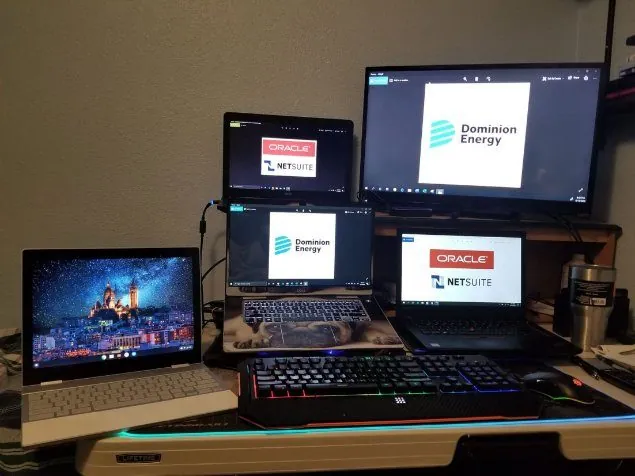
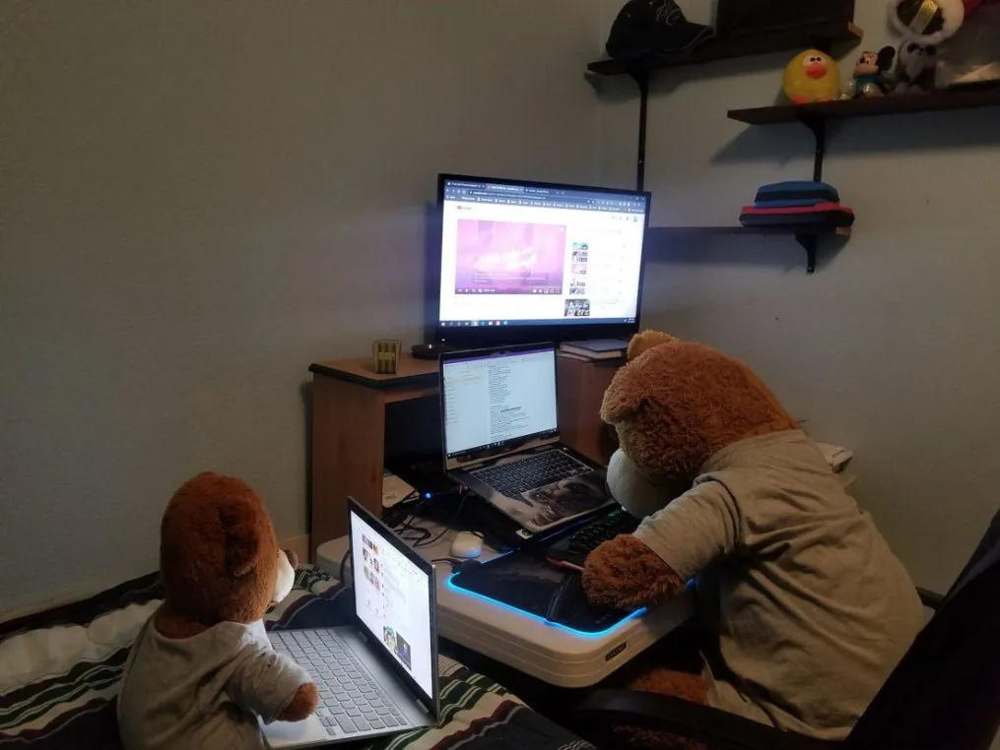
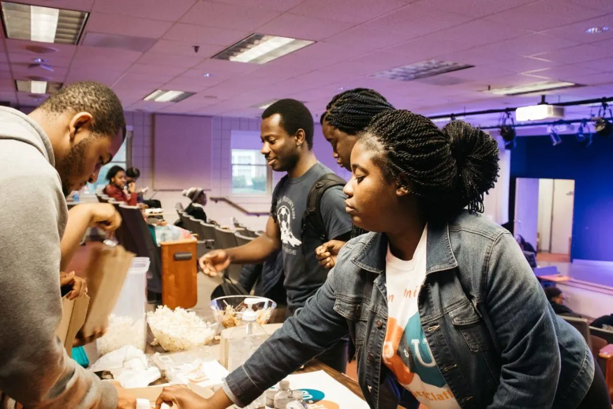
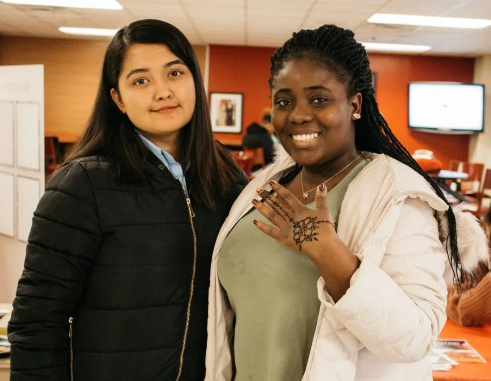
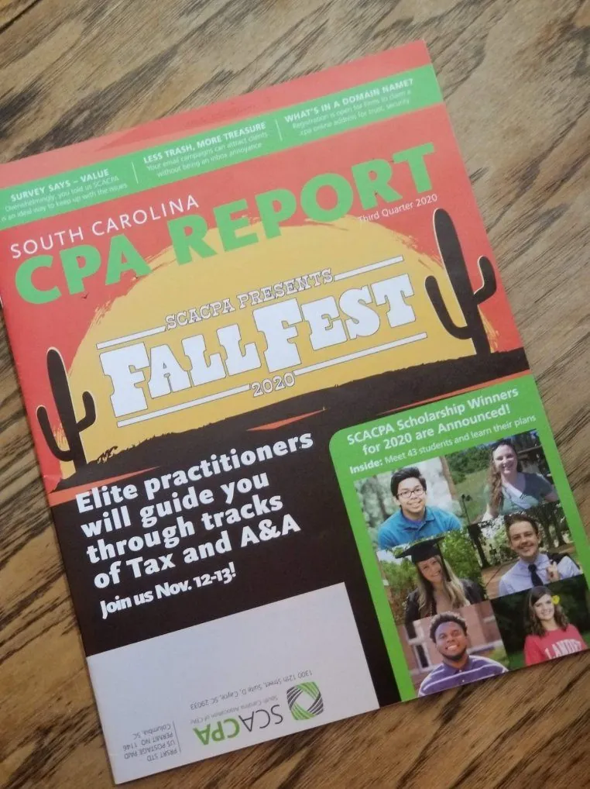
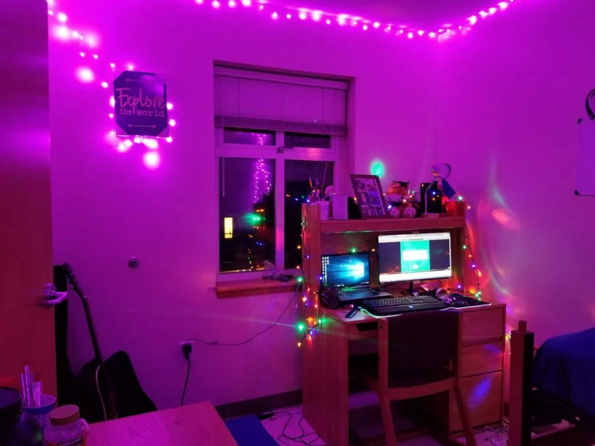
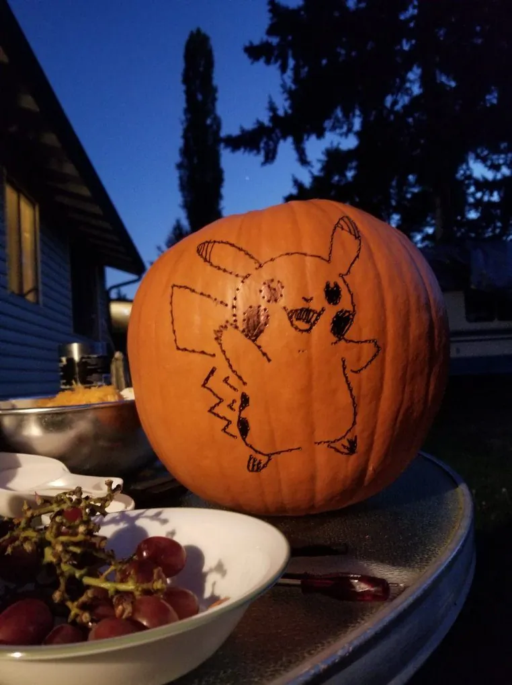

What a year this has been…

This article took me a lot of courage to write as I encountered so much negativity, toxicity, and despondency which heavily influenced my energy levels. In fact, as I try to focus on all the great things that happened this year, I cannot help myself but to shed tears from reminiscing the number of deaths I’ve encountered this year all the way to almost losing all my assets. Moreover, the drastic feeling of depression which led for me to gain 15 pounds in the span of a month and ignore the people that cares the most about me.

But, I also have learned how to shift my perspective and try to get the best out of a certain situation. I’ve learned how to reinvent myself so many times to adjust with the flow of the events. I’ve learned how to constantly improvise, overcome, and adapt.

> When a photographer can’t change a scene, they either change their angles or their lens to capture the best of that scene. Similarly, when you cant change a situation in your life, change your perspective to get the best out of that situation.

## Highlights
- Interned with Oracle NetSuite and Dominion Energy which are both Fortune 100 companies
- 4.0 GPA and certification in Financial Modelling and Valuation Analyst from Corporate Finance Institute and Business Analytics from Harvard Business School Online
- Got invited for speaking opportunities and was featured in various magazines and newspaper!
- Won 7 scholarships and represented Claflin University in more than 5 different virtual conferences!
- Started a more hands-on approach in trading rather than passive investing!
- Carved my first pumpkin and went to a pumpkin patch!
- Learned how to cut my own hair and decorated my dorm room!
- Helped 9 high school students get accepted to their dream universities with a full scholarship!
- Got myself a new laptop fully funded by me!
- Reconnecting with my Filipino Roots by reaching out to more Filipinos in the Philippines!

## Virtual Summer Internship with Oracle and Dominion Energy
Having the opportunity to do a paid internship with Oracle as a Field Marketing Intern and Data Analyst with Dominion Energy is one of my biggest achievements in 2020. I can still remember when I was applying for different companies and was constantly rejected. I think that I applied to a total of 50 different internships and was only accepted to 10 of them.

Doing two virtual 40 hour internships over the summer with a pandemic going on was crazy. In addition to that, I was also located in PST when both of my internships was based in EST. Luckily, both of my managers were very accommodating and I was able to do my best at each of my internship and get an outstanding review of my performance.

In Oracle, I interned with the NetSuite Marketing team based in Denver, Colorado. As a Finance and Computer Science major, this was a step outside of my comfort zone as my main skills are in quantitative and technical analysis. However, I did gain a lot of qualitative skills as the President of two organizations during the school year at my university.

During the course of my internship, I worked within the intersection of sales and marketing by building productivity and customized tools to fill the gap and increase profits. I also built collaterals to help the Competitive Intelligence team provide actionable insights to executive members. For my final intern project, I created an in-depth presentation about how emerging technologies such as virtual reality and artificial intelligence can be utilized to radically enhance the ERP experience for consumers.

In Dominion Energy, it was a completely different experience compared to Oracle. I was with the Gas Development side as a Business Analyst and it was more of a technical experience. I developed an algorithm to effectively compare different forecasts of gas prices using tableau, excel, and a little bit of SQL. I also built a data map that consists of Dominion Energy assets that was utilized for managerial action and strategy of developing and acquiring other infrastructures. For my final project, I worked with a team of interns where we collaborated on improving the virtual onboarding process for the next group of interns.

It was also during this summer when the team that I was working with got acquired by Berkshire Hathaway and the Atlantic Coast Pipeline was cancelled. It was a learning moment for me since I get to witness how the acquisition was made and the changes that accompanied it. I’m really looking forward to see how Berkshire Hathaway plans to utilize their newly acquired assets in building more pipelines around the United States.

## Certifications from Harvard Business School Online and Corporate Finance Institute + a 4.0 GPA
Prior to my sophomore year, I developed an interest on how to create financial models for businesses to utilize for better financial decisions.

Two months later, I was awarded with a generous financial aid from Corporate Finance Institute. However, as an undergraduate student with zero experience in financial modelling, I was unable to advance quickly as I made sure to embrace each topic presented and explored various ways on how I can apply it to my life.

After a year and a half, I have finally earned my Financial Modeling & Valuation Analyst Certification from Corporate Finance Institute. In addition, I was also selected as a CFI scholar! From budgeting and forecasting all the way to Excel VBA and modelling, I highly recommend this program to anyone interested in becoming a world-class financial analyst.

I also got a scholarship from Net Impact to take the Business Analytics course from Harvard Business School Online! This course completely changed my outlook in business as it exposed me to the importance of using data to make better managerial decisions! Before taking this course, my focus was mostly on compiling and gathering data. But, after this course, I learned so much about probabilities, statistics, A/B testing, and so much more.

It also introduced me to a global network of Filipinos who have taken their MBA at Harvard University. At first, it was very intimidating to network with them as I am still a student, but after doing a zoom session with them, I immediately felt like home and has always reached out to them whenever I needed help with anything!

 and Financial Modeling and Valuation Analyst from Corporate Finance Institute (right)")
Lastly, did I mentioned that I got a 4.0 this semester despite doing a virtual semester and waking up at 6am in the morning because I am in PST and my classes are at ET? It took me about not sleeping twice at night per week, but I was able to persevere and finish! Now, I am sleeping more than 12 hours per day during this winter break.

## Claflin University → Zoom University
In the spring semester, when the Coronavirus was still not around, I served as the Campus Leader for the nationwide Up to Us competition. As a campus leader, I mobilized over 750 students at Claflin University to advocate for a sustainable fiscal future by creating an informative and creative campaign. We hosted game nights, movie shows, and a lot of other events to engage future leaders and educate them about the importance of being aware of the national debt and how it affects us in the future.

I was also the President for the Global Student Organization at Claflin University where we host various cultural activities to help promote global awareness in our campus community. We also do sessions to prepare international students for scholarships, internships, and any other concerns that are relevant within the international environment at my university.

For this semester, we were planning to do more events, but was abrupted due to the pandemic. However, we did have the first Henna event at Claflin University and had a lot of students who were more than happy to be a part of it!

Then, around March of 2020, Coronavirus became a thing. Universities have to shutdown and everything was moved to a virtual environment. As an out of state student, I was stuck in my university and it immediately became one of my darkest moments in life. My savings in the stock market from me working different jobs during my high school exponentially dropped. Six of my friends died due to an accident. I started stress eating and I gained 15 pounds in such a quick moment of time.

During the fall semester, I started remote learning while being based on a different time zone. It was very difficult to adjust, but I was able to overcome it by setting a healthy schedule on sleeping early and waking up early to start my day. I also learned the importance of getting enough time outside! At first, I was spending more than 15 hours in front of my computer. But, after having a severe headache, I started taking 20 minutes break for every 3 hours I spend working.

## Expanding my Personal Brand
In 2019, I started a journey of improving my personal brand online and offline. I created my website and finally had the time to improve it this year after learning how to A/B test websites. I also was able to expand my LinkedIn followers to 3,000 this year! For 2021, I am aiming to reach 5,000 connections and make quality motivational posts rather than doing the traditional “I got accepted” posts!

In addition to having more than 3,000 connections in LinkedIn, I was also selected as one of the winners of the AICPA scholarships and was featured on their websites and magazine!

I can still remember when my teacher called me during one of our virtual class sessions and asked me if I have seen the South Carolina CPA Report Magazine. At first, I was confused because I really have not even heard about it before. But, when she told me that I was featured in it, I got really excited and made sure to get a copy as soon as possible.

I also served as one of the guest speakers for the first Up to Us Leadership Boot Camp this year! I mainly talked about how to embrace the new normal and how students can develop new skills that can not only be utilized for the Up to Us competition but on their day to day activities as well.

## Investing + Fun Activities!
When the pandemic first started, the stock market massively plummeted and all I can think of was all my hard work going down the drain. At that time, all my assets were in the stock market and I did not have any remaining savings. The SPY index, which measures the performance of top 500 companies in the United States dropped from $338 to $222 in 1 month!

Therefore, I have decided to start a more hands-on approach in investing! I started learning about day trading, swing trading, and the pros and cons of different brokerages in regards with trading. I also started studying technical analysis of a certain stock and learning how major events can affect a stock performance.

In the end, I was able to gain a tremendous 488% increase in one week, but decided to take it a little bit easy because of the stress that comes along with it. During that week, I spent at least around 15 to 18 hours of researching different stocks and tracking the market per day.

Not only did I learned how to actively trade on the market, I also have decorated my dorm room with lights and connected it to my Alexa speaker! Every morning, I programmed my Alexa to wake me up at a certain time and it greets me by singing a new song every day! I can also tell Alexa to turn my lights on and off.

I also carved my first pumpkin this year and got a new laptop this year! This is the first time that I actually ordered a brand new laptop. In the previous years, I usually go with a refurbished one or buy a used one in eBay because it is cheaper and I know how to troubleshoot and fix laptops. The laptop that I got is a Dell XPS 15 9500. It is the 4K variant with 16GB of RAM, 512GB SSD, i7-10750H and a Nvidia GTX 1650 Ti. I mainly decided to go with this one because of the 16:10 aspect ratio which is very crucial for me as I plan to use this laptop for productivity and editing videos.

## Plans for 2021?
I will be making a more in-depth article about my goals for 2021 but in summary, I plan to:
- Publish 50 articles in Medium
- Become more active on YouTube, Twitter, and Instagram and be more authentic in LinkedIn and Facebook!
- Establish a social impact project in the Philippines! Impact over income!
- Create a workout routine and consistently lose weight!
- Finish 12 books
- Schedule 5 coffee dates with friends every month

For 2021, my word of choice would be relationships! I am aiming for a year of friendships, new people, and nurturing relationships. After all, strangers are just friends waiting to meet.

Huge shoutout to all the people and family who stick with me till the end of this year! Special shoutout to the new people I met through reddit, Quora, Facebook, and especially Tinder! I would not be where I am right now if it were not for you all!
